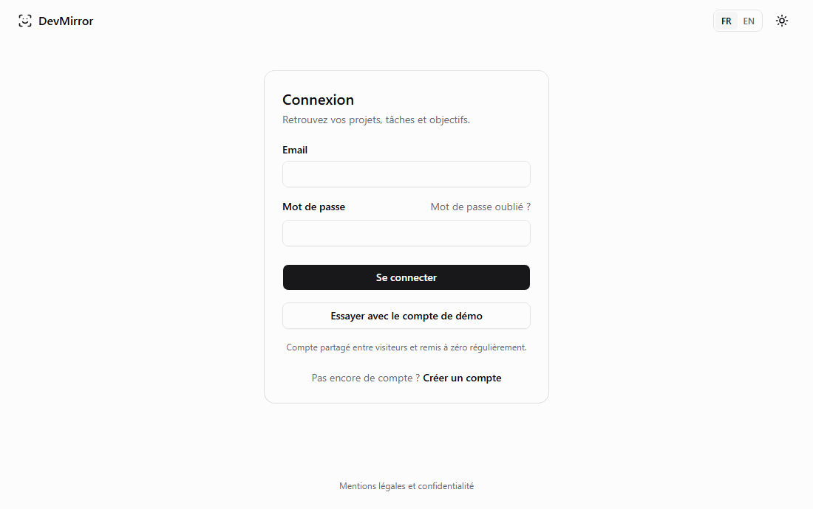
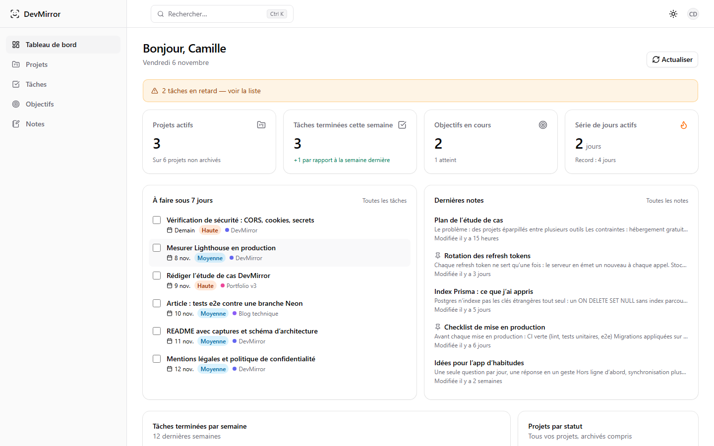
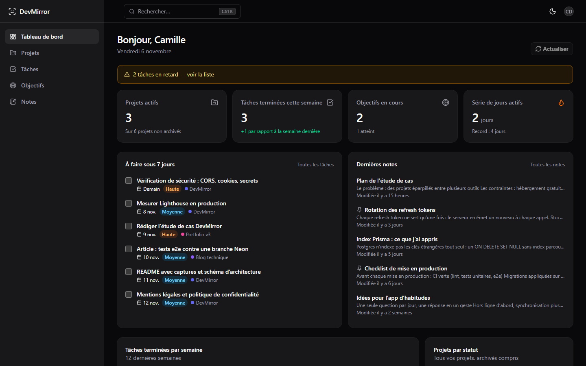
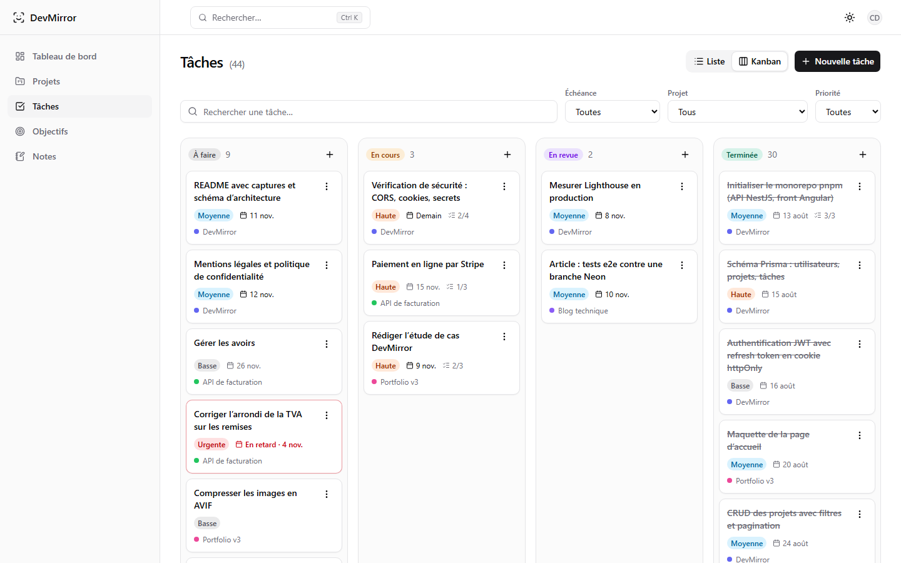
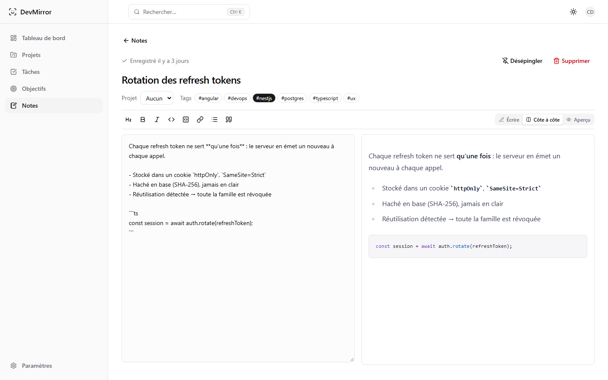
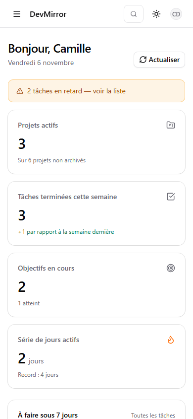
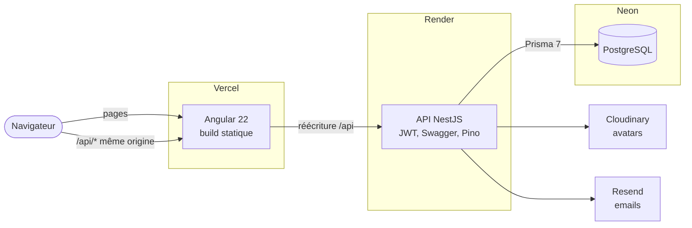

# DevMirror

Gestion de projets pour développeurs : projets, tâches en Kanban, objectifs et jalons, notes
Markdown, et un tableau de bord qui montre la progression. Application full-stack Angular 22 et
NestJS, en français et en anglais, déployée sur Vercel, Render et Neon.

**[Ouvrir l'application](https://real-dev-mirror-5q1b.vercel.app)** — bouton « Essayer avec le
compte de démo » sur la page de connexion (`demo@devmirror.dev` / `DemoDevMirror2026`).



L'API est sur le plan gratuit de Render : après 15 minutes d'inactivité, la première requête
prend environ 30 secondes.

## Fonctionnalités

- **Projets** : statut, technologies, liens, tags, progression calculée depuis les tâches.
- **Tâches** : liste filtrable ou Kanban avec glisser-déposer (clavier compris), priorités,
  échéances, sous-tâches.
- **Objectifs** : jalons à cocher, date cible, projets liés.
- **Notes** : éditeur Markdown avec aperçu et coloration du code, épinglage, recherche plein texte.
- **Tableau de bord** : indicateurs, tâches terminées par semaine, projets par statut, heatmap
  d'activité sur un an, échéances des 7 prochains jours.
- **Recherche globale** `Ctrl+K`, thème clair ou sombre, français ou anglais, préférences
  enregistrées dans le compte.
- **Compte** : vérification de l'email, mot de passe oublié, photo de profil, export de toutes les
  données en JSON, suppression du compte.

| Tableau de bord                                     | Mode sombre                                                               |
| --------------------------------------------------- | ------------------------------------------------------------------------- |
|  |  |
| **Kanban**                                          | **Note Markdown**                                                         |
|         |               |



## Architecture



- **Même origine** : Vercel réécrit `/api/*` vers Render ; le cookie de session `SameSite=Strict`
  suffit contre le CSRF.
- **Session** : jeton d'accès de 15 minutes en mémoire, refresh token en cookie `httpOnly` avec
  rotation et détection de réutilisation ([ADR 0002](docs/adr/0002-session-jwt-refresh-cookie.md)).
- **Contrat typé** : le client TypeScript du front est généré depuis le Swagger de l'API ; la CI
  échoue s'il n'est pas à jour.

| Couche          | Technologie                                                                |
| --------------- | -------------------------------------------------------------------------- |
| Frontend        | Angular 22 (standalone, zoneless), NgRx Signal Store, Spartan UI, Tailwind |
| Backend         | NestJS 12, class-validator, Swagger, Pino, Sentry (option)                 |
| Base de données | Prisma 7.10, Neon PostgreSQL                                               |
| Tests           | Vitest, Supertest, Playwright, axe-core                                    |
| Monorepo et CI  | pnpm workspaces, GitHub Actions                                            |

```text
apps/web          Angular (features/ par fonctionnalité, core/, shared/)
apps/api          NestJS (modules/ par domaine), Prisma, seed du compte de démo
libs/api-client   types générés depuis le Swagger
docs/             ADR, déploiement, sécurité
```

## Installation

Prérequis : Node 24, pnpm 10, une base PostgreSQL (une branche Neon gratuite suffit).

```bash
git clone https://github.com/EKRAANGEEPHRAIM/REAL-DEV-MIRROR.git && cd REAL-DEV-MIRROR
pnpm install
cp apps/api/.env.example apps/api/.env   # puis renseigner DATABASE_URL et JWT_ACCESS_SECRET
pnpm --filter @devmirror/api prisma:deploy
pnpm api:dev   # API sur http://localhost:3000, Swagger sur /api/docs ; dans un autre terminal : pnpm web:dev
```

Le front tourne sur http://localhost:4200. Sans `RESEND_API_KEY`, les emails (et leurs liens)
s'affichent dans les logs de l'API. Pour un compte rempli :
`pnpm --filter @devmirror/api build && pnpm --filter @devmirror/api seed:demo -- --confirm`.

## Tests

Environ 650 tests et contrôles tournent à chaque pull request.

```bash
pnpm test                                        # unitaires, API et front (seuil 70 % par service)
pnpm --filter @devmirror/api test:e2e            # e2e de l'API sur une base de test
pnpm --filter @devmirror/web e2e --project=audit # 15 pages × 4 largeurs, WCAG 2.2 AA, CSP
E2E_API=1 pnpm --filter @devmirror/web e2e --project=parcours   # parcours complet, vraie API
```

Le parcours (inscription → projet → tâches → tableau de bord → suppression du compte) se lance
aussi contre la production : `E2E_BASE_URL=https://… E2E_API=1`. Détails dans
[ADR 0005](docs/adr/0005-tests-trois-niveaux.md).

## Qualité

- **Performance** : bundle initial de 499 ko (125 ko transférés) ; Lighthouse ordinateur 98–100,
  mobile 86–91 sur les pages publiques de production ; accessibilité, bonnes pratiques et SEO à 100.
- **Accessibilité** : WCAG 2.2 AA vérifiée par axe-core sur chaque page, en clair, en sombre et
  en anglais ; navigation complète au clavier.
- **Sécurité** : CSP stricte, limitation de débit par IP et par compte, aucune donnée sensible
  dans les logs ; vérification documentée dans [docs/securite.md](docs/securite.md).

## Documentation

- [Décisions d'architecture (ADR)](docs/adr/)
- [Déploiement](docs/deploiement.md) (Neon, Render, Vercel) et compte de démo
- [Sécurité](docs/securite.md)
- API en ligne : [Swagger](https://devmirror-api.onrender.com/api/docs)
